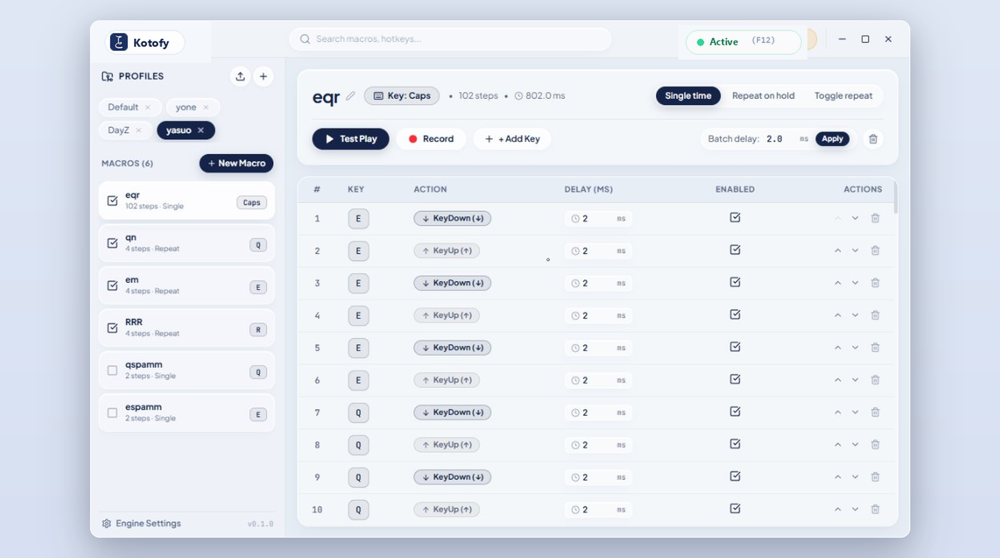

<div align="center">

  

  <br />
  <br />

  <h1>琴 · Kotofy</h1>
  <p>
    <strong>Pure Speed</strong> &nbsp;│&nbsp;
    <strong>Zero Latency</strong> &nbsp;│&nbsp;
    <strong>Hardware-Grade Precision</strong>
  </p>

  <p>
    <em>The modern, ultra-low latency macro automation engine for competitive gaming and desktop workflows.</em><br />
    <small>Engineered with Japanese aesthetic minimalism, hybrid sub-millisecond QPC scheduler, and zero compromises.</small>
  </p>

  <p>
    <a href="https://github.com/prfctcondition/kotofy/releases/latest"></a>
    
    
    
    
    
    
    <a href="LICENSE"></a>
  </p>

  <br />

  <p>
    <a href="https://github.com/prfctcondition/kotofy/releases/latest">
      
    </a>
  </p>

  <br />
</div>

---

## ✦ Why Kotofy?

> *Legacy macro engines built on heavy frameworks suffer from jittery OS timers, unpredictable GC pauses, and cluttered interfaces.*

**Kotofy is a ground-up reimagining of the legacy Zen Zakura Macro.**

Rebuilt completely from scratch in **Rust** and **Tauri v2**, Kotofy delivers orders-of-magnitude faster responsiveness, true sub-millisecond execution accuracy, minimal CPU footprint, and a breathtaking Nordic Liquid Glass interface. Everything has been elevated: lower latency, instant hotkey binding, hardware-level scancode injection, zero-overhead process targeting, and seamless background tray management.

---

## ✧ Core Architecture & Features

### ▸ 01. Hybrid Sub-Millisecond Scheduler
- **Hardware-Level Precision**: Leverages `QueryPerformanceCounter` (QPC) combined with multimedia timer resolution (`timeBeginPeriod(1)`) to eliminate standard Windows 15.6ms sleep quantums.
- **Zero-Drift Micro-Sleep**: Hybrid spin-wait algorithm that sleeps cooperatively for long intervals and spins during final microseconds, delivering sub-0.05ms dispatch accuracy.
- **Pure Low-Level Injection**: Employs Windows `SendInput` with true hardware scancodes (`KEYEVENTF_SCANCODE`) to ensure 100% bypass of input drops in competitive games.

### ▸ 02. Zero-Overhead Active Window Filtering
- **Atomic Hot Path**: Macro execution checks window focus using an atomic memory load (`IS_TARGET_ACTIVE.load(Relaxed)`) with 0ns overhead and zero heap allocations.
- **Dedicated Background Watcher**: A 50ms background thread monitors foreground window transitions, resolves root process executables (`GetAncestor(GA_ROOTOWNER)` + `QueryFullProcessImageNameW`), and safely prevents handle leaks.

### ▸ 03. Multiple Execution Modes
- **Single Execution**: Fires the sequence once per hotkey trigger.
- **Repeat While Held**: Loops cleanly while the assigned key is pressed down, immediately breaking upon release.
- **Toggle Loop**: Toggles continuous playback on first press, stops on second press.
- **Global Emergency Killswitch (F12)**: Instantly halts all active macros, disarms repeat threads, and resets any held virtual keys across the system.

### ▸ 04. Nordic Liquid Glass UI
- **Pristine Aesthetics**: Frosted glass panels, subtle border reflections, and crisp typography crafted for clarity.
- **Multi-Profile Management**: Create, switch, and export tailored profiles for different games or workflow sets.
- **Live Sequence Recorder & Step Editor**: Record real-time inputs with microsecond timings, adjust delays in bulk, and rearrange key steps with drag-and-drop simplicity.

### ▸ 05. Native System Tray & Window Lifecycle
- **True Background Operation**: Minimizing or closing the window tucks Kotofy into the system tray with zero taskbar footprint (`skip_taskbar`).
- **Instant Restore**: Left-click the high-resolution tray icon or use the native context menu to bring the window back into focus in milliseconds.

---

## ⚡ Architectural Comparison

| Dimension | **Kotofy (Rust v1.0)** | **Zen Zakura Macro (Legacy)** | **Generic Macro Tools** |
| :--- | :--- | :--- | :--- |
| **Engine Runtime** | **Native Rust + Win32 API** | C# / .NET Framework | C# / Electron / Python |
| **Timer Precision** | **< 0.05 ms (QPC + spin-wait)** | ~15.6 ms (Thread.Sleep) | 10 – 20 ms OS jitter |
| **Process Filter Overhead** | **0 ns (Atomic background watcher)** | Synchronous Win32 calls | Polled WMI / Process list |
| **Memory Consumption** | **~35 MB** | ~180 MB | ~300+ MB |
| **UI Aesthetics** | **Nordic Liquid Glass (React 19)** | Classic WPF | Generic dark mode |
| **Input Injection** | **Hardware Scancodes (SendInput)** | Virtual Key codes | Virtual Key codes |
| **System Tray Integration** | **Zero-taskbar tray with quick restore** | Basic minimize | Inconsistent tray hooks |
| **License & Privacy** | **MIT License · 100% Offline** | Closed source | Account login / Telemetry |

---

## ⚙ Installation

### Windows Setup (Recommended)
1. Download the latest installer from the [Releases page](https://github.com/prfctcondition/kotofy/releases/latest):
   - **`Kotofy-Windows-Setup-v1.0.0.exe`**
2. Run the setup wizard to install Kotofy to your system with desktop and Start Menu shortcuts.
3. Launch Kotofy and configure your gaming profiles.

---

## ⚙ Building From Source

### Prerequisites
- [Rust](https://rustup.rs/) *(latest stable toolchain)*
- [Node.js](https://nodejs.org/) *(v18 or newer)*
- Windows 10/11 with C++ Build Tools

### Setup & Run
```bash
# 1. Clone the repository
git clone https://github.com/prfctcondition/kotofy.git
cd kotofy

# 2. Install UI dependencies
npm install

# 3. Launch Desktop Development Environment
npm run tauri dev
```

### Packaging Production Binary & Installer
```bash
# Compile release binary
npm run tauri build

# Compile Inno Setup installer
iscc installer.iss
```
The output installer will be generated in `installer_output/Kotofy-Windows-Setup-v1.0.0.exe`.

---

## ☆ Support

Kotofy is 100% free, open-source, and dedicated to pure performance and privacy. There are zero subscriptions, ads, or trackers.

If Kotofy brought precision to your setup or enhanced your gaming experience, support for the craft is received with quiet gratitude:

<p align="center">
  <a href="https://ko-fi.com/prfctcondition">
    
  </a>
  <br />
  <sub><a href="https://ko-fi.com/prfctcondition">ko-fi.com/prfctcondition</a></sub>
</p>

---

## ✦ Engineering & Philosophy

Kotofy was engineered as a high-performance, zero-overhead desktop companion. Reimagining the original Zen Zakura Macro in Rust allowed stripping away all runtime bloat, GC stutters, and UI latency.

> *「 Craft with intent, ship without bloat. 」*

## 🕮 License

Distributed under the [MIT License](LICENSE). Built for players and creators who value speed, precision, and craftsmanship.
